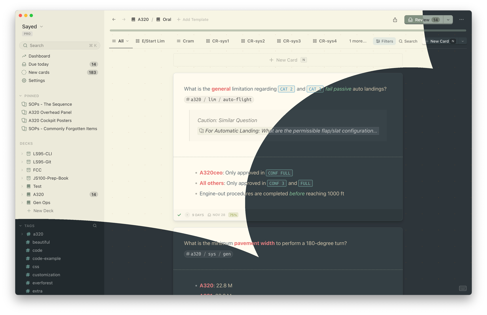

<div align="center">



# Everforest Theme for the Mochi.cards App

A beautiful, customizable [Everforest](https://github.com/sainnhe/everforest) color scheme for the [Mochi](https://mochi.cards) flashcard application. This theme provides custom dark and light modes for excellent readability and visual comfort.

<a href="https://buymeacoffee.com/sydalwedaie"> </a>
</div>

## Features

- Seamless dark and light theme variants in one file.
- Three contrast levels (hard, medium, soft) for both dark and light modes (default medium dark, hard light).
- Optional colorful heading styles (H1-H6).
- Optional custom numbered bullets and indent lines.
- Custom font family and styles for standard and extended markdown syntax.
- Custom inline code blocks.
- Custom keyboard input (`<kbd>`) styling.
- Multi-color highlighted text (`==text==`).
- Enhanced table styling with alternating row colors.
- Opinionated layout fixes for the Grid and Column views.

## Installation

Copy the compiled CSS file (`everforest-primary.css` in the root directory) to your Mochi custom CSS location:

- Navigate to Mochi's settings
- Find the Custom CSS theme option
- Import `everforest-primary.css`

> [!IMPORTANT]
> You need to redo the above steps every time you update the theme file!

Once installed, the theme automatically adapts to your Mochi dark/light mode setting. No additional configuration is needed for basic usage. If you want to customize the theme, use the SCSS source files (see Customization section below)

## File Structure

The main entry point is `everforest-primary.scss`. It imports all the components from the `src/components` directory, which eventually compiles into the output `everforest-primary.css` in the root directory.

```
├── everforest-primary.css                 # Compiled output (ready to use)
└── src
    ├── assets
    │   ├── _colors.scss                   # Everforest colors (all variants)
    │   ├── _settings.scss                 # Custom settings options
    │   └── _tools.scss                    # SASS mixins
    ├── components
    │   ├── _base.scss                     # Base styles for the whole app
    │   ├── _fixes.scss                    # Minor UI fixes
    │   ├── _layout.scss                   # Opinionated layout fixes
    │   ├── _syntax-highlighting.scss      # Everforest syntax highlighting
    │   ├── _typography.scss               # Cards typography styles
    │   └── _variables.scss                # Global variables (light, dark, common)
    └── everforest-primary.scss            # Main entry point

```

## Customize Using SCSS

The theme is built with SCSS and offers a few customization options:

1. **Prerequisites**: [Install SASS](https://sass-lang.com/install)
2. **Edit Settings**: Open `_settings.scss` and modify as desired:
3. **Compile**: Generate the CSS file

```bash
sass --watch src/everforest-primary.scss everforest-primary.css
```

## Customization Options

### Contrast Levels

- **Hard**: Maximum contrast between background and foreground (default for light mode)
- **Medium**: Balanced contrast (default for dark mode)
- **Soft**: Lower contrast for reduced eye strain

### Rainbow Headings

Enable or disable colorful heading styles by setting `custom-rainbow-headings` to `true` or `false`. When enabled, you can customize which color is applied to each heading level (H1-H6) using the `rainbow-colors` list.

Available colors: `red`, `orange`, `yellow`, `green`, `aqua`, `blue`, `purple`

> Note: The default for H1 heading is foreground color.

### Custom Components

- `custom-button-3d` adds a 3D effect on some UI buttons.
- `custom-assets-shadow` adds a subtle shadow around images and videos, making them pop.
- `custom-ol-bullet` adds rounded custom bullet numbers and indentation lines.
- `custom-highlights` adds 4 different highlight options by mixing Markdown's `==`, `_` and `**` syntax.
- `custom-bg-pattern` adds a subtle background dot pattern to the main content area.

## Deeper Customization

What you can customize in `_settings.scss` is limited to what I thought was sensible. But you are welcome to modify the `.scss` source files directly. You might want to note the following:

### `_variables.scss`

This is the most essential piece of the theme. It redefines a couple of Mochi-specific CSS custom properties for both light and dark variants. They are in the format `--mochi--*`. I tried using these as much as possible as opposed to redefining actual CSS rules. These variables alone go a long way in changing the theme.

### `_base.scss`

Many times I had to target elements directly, since I could not find a dedicated Mochi variable (there are hundreds of them and I might have missed what I needed). For example, the Mochi variable for changing the background of the main content area also sets the sidebar background color. That's what is happening in `_base.scss`

Most of the styles here are about changing colors. However, there are some opinionated styles as well, such as setting slightly different font sizes and borders.

> [!NOTE]
> This file (`_base.scss`) along with `_variables.scss` sets the base styles to an Everforest look and feel. The following files are completely optional. You can safely remove them from `everforest-primary.scss` to completely exclude their styles.

### `_typography`

This file makes extensive, opinionated changes to all sorts of card typography styles. Some margins and paddings have been altered, and custom fonts are set for heading and body text, along with specific font sizes that in my opinionate better work with the custom fonts.

### `_layout.scss`

This file contains opinionated layout changes to the Grid, Column, and Notebook views. For example, I increased the width of cards in the Grid view and made some aesthetic changes to the Column view.

### `_misc.scss`

This file contains opinionated aesthetic improvements to some of the components. For example, shadows around card assets, a 3D effect on some of the UI buttons, and custom bullet styles.

### `_fixes`

This file includes very specific fixes to some parts of the UI.

### `_syntax-highlighting.scss`

Mochi ships with built-in syntax highlighting in code blocks. This file simply applies the Everforest color scheme.

## References

- [Original Everforest by sainnhe](https://github.com/sainnhe/everforest)
- [Obsidian Primary Theme](https://primary-theme.github.io/)
- [Mochi Website](https://mochi.cards)
- [Sass Docs](https://sass-lang.com)

## Contributing

Feel free to customize this theme to your preferences! If you create improvements or variants, consider sharing them with the [Mochi community](https://forum.mochi.cards/).

## License

This theme is based on the Everforest color scheme and the Obsidian Primary theme. Please refer to the original repositories for licensing information.
